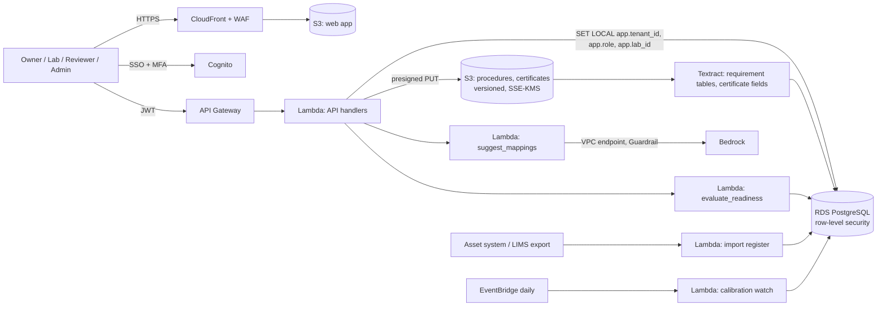

# Benchrelay: proposed AWS architecture

Status: this is a design, not a running system. The website and the prototype at `/app` are static front ends. `db/schema.sql` was loaded into PostgreSQL 16 and checked by `db/test_rls.sql` (tenant isolation, receiving-lab scoping, value provenance, reviewer independence, the readiness gate, revocation and the append-only audit). The Lambdas in `backend/` are unit-tested and share fixtures with the prototype engine. Nothing is deployed. The services match the website's architecture section: Cognito, S3, Textract, Bedrock, Lambda and RDS for PostgreSQL.

## 1. Overview

| Concern | Decision |
|---|---|
| Identity | Cognito, optionally federated. Groups `owner`, `lab` (with a lab claim), `reviewer`, `admin`. |
| Authorisation | Handlers set `app.tenant_id`, `app.user_id`, `app.role` and `app.lab_id` per transaction. Row-level security keeps tenants apart, limits lab users to their own register and requests, hides assessments from labs, lets only owners map and only labs record capabilities, and gives only admins the audit log. This mirrors `src/app/actions.js`. |
| Procedures | Uploaded PDFs; Textract extracts requirement tables. Extracted requirements are confirmed by the method owner before use. |
| Register | Imported from the asset system or LIMS, or entered by the lab. Every capability value carries its source (a NOT NULL `source_ref`). |
| Evaluation | `backend/lambdas/evaluate_readiness`: unit-converted comparisons (at least / at most), and calibration validity until the transfer date plus the tenant margin. Results are written to `requirement_result`. Same fixtures as the prototype. |
| AI | `backend/lambdas/suggest_mappings`: Bedrock Converse with a Guardrail. Only the requirement text and equipment descriptions are sent, and both quotes must match or the suggestion is dropped. |
| Gates in the database | Only reviewers approve measures or record readiness, and never the method owner. “Ready” needs every result met or covered by an approved measure, and no open requests (`check_readiness`). Mapping, disposition, capability or calibration changes revoke readiness, and a re-evaluation revokes only when a result changes. |
| Calibration watch | A daily job flags certificates falling due within the margin of planned transfers. |

## 2. AI controls

1. AI only suggests mappings; comparisons are rules and decisions are people's.
2. No client, laboratory, people or serial data is sent (`check_input`).
3. Quotes must exist verbatim, the equipment id must be known, and malformed output fails closed.
4. Pending until the method owner decides; dismissals need a reason.
5. A per-tenant switch; the confirmation rate is shown on the admin overview.
6. Use Bedrock under terms that exclude customer content from training, and record this in the data-processing agreement.

## 3. Security and retention

KMS on RDS, S3 and logs; TLS 1.2+ with `verify-full`; RDS Proxy; private subnets; VPC endpoints; least-privilege IAM; malware scanning of uploads; and logs with IDs only. Proposed retention: transfer records, results and decisions for the life of the method plus 10 years, or the laboratory's quality-system requirement if longer; certificates for the same period; exports 30 days. All of this needs confirming per customer.

## 4. Not validation

Benchrelay prepares a transfer for expert review. It does not validate methods, qualify instruments, certify laboratories or control equipment. Laboratories remain responsible under their own quality systems (for example ISO/IEC 17025).
